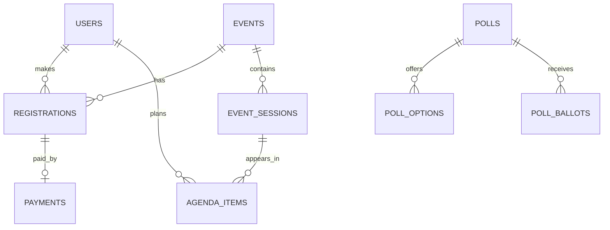

# Documentation & deliverables

Serves: DEL-1, DEP-1, DOD-1, QUAL-1, TEST-1, TEST-2, TEST-3, SETUP-2, SETUP-3, BE-1.
Related: `api-design` (collection stays in sync), `testing` (report), `git-workflow`, `database-drizzle` (ER diagram). Commands: `/api-collection`, `/test-report`, `/deliverables-check`. Documentation = 10% of the grade, and reviewers read it first.

## Deliverables (spec §13)
| Deliverable | Where |
| --- | --- |
| Source code repository | GitHub; branches per `git-workflow` |
| Live application URL | Vercel production (DEP-1) listed in README |
| API collection | `docs/api/eventsphere.postman_collection.json` **or** `docs/api/bruno/` (pick one) |
| Test report | `docs/test-report/README.md` + coverage + Playwright report |
| Technical documentation | `docs/architecture.md` (+ `docs/decisions/*.md`, `docs/setup.md`, `docs/env.md`, `docs/requirements-coverage.md`) |

## MUST
- **README.md** (replace the create-next-app text): what EventSphere is, live URL, screenshots, tech stack, quick start (`pnpm i`, `cp .env.example .env.local`, `pnpm db:up`, `pnpm db:migrate`, `pnpm db:seed`, `pnpm dev`), scripts table, demo accounts (dev seed only), project structure summary, links to docs.
- **Architecture doc**: system context diagram (browser ↔ Next.js (RSC + Route Handlers) ↔ Postgres/CMS/Stripe/Sentry/Blob/Resend), **backend layers** (route → service → repository) with one worked request, frontend layers (feature modules, RTK Query, slices), **ER diagram** (Mermaid `erDiagram` generated from the Drizzle schema, kept in `docs/` and updated with each migration), auth/session flow, payment flow (sequence diagram), SSE flow, PWA caching table, security measures (BE-7), environments (local Docker, preview, production), key decisions and trade-offs (why Route Handlers + services, why Drizzle, why SSE polling DB, why Serwist). Use Mermaid so diagrams are versioned.
- **Setup doc**: prerequisites, Docker Compose usage, env vars table (`docs/env.md`: name, purpose, where used, public/secret, example; mirrored in `.env.example` with **no real secrets**), Stripe CLI webhook steps, CMS space setup + webhook, Sentry project, Vercel + Neon deployment, migration procedure for production.
- **Decision log** (`docs/decisions/NNN-title.md`, short ADRs): CMS choice, password hasher, rate-limit store, Serwist/Turbopack approach, registration cancellation/refund policy, DnD library variant.
- **Requirements coverage** (`docs/requirements-coverage.md`): table ID → implementation (files/routes) → tests → status; generated from the catalog + code by `/check-spec`.
- **API collection** (`/api-collection`): enumerate every `app/api/**/route.ts` (method, path, auth, request schema, response schema) and generate requests with: environment variables (`baseUrl`, `sessionCookie` or auth steps), example bodies derived from Zod schemas (valid payloads), saved example responses, tests/assertions for status + envelope shape, folders per module, a login request that stores the session cookie, Stripe webhook example with a note about signatures. Re-run whenever a route or schema changes.
- **Test report** (`/test-report`): environment, commands, unit/integration/E2E counts and results, coverage %, failing/skipped tests with reasons, screenshots/traces for E2E failures, mapping of tests to requirement IDs, known gaps.
- **Pre-submission check** (`/deliverables-check`): DEL-1 items exist and are current; Definition of Done (below) verified with evidence.

## Definition of Done (spec) → evidence
| Spec item | Evidence |
| --- | --- |
| All mandatory modules implemented | catalog: every non-bonus ID `Done` |
| Application deployed | Vercel production URL responds; env vars working; migrations applied (DEP-1) |
| All integrations functional | Stripe test payment confirmed via webhook; CMS content live + revalidation; Sentry receives a test error; SSE notifications; Blob upload; email/reset link |
| Test cases passing | CI green; test report attached |
| Code review feedback addressed | merged PRs have resolved conversations (DOD-1) |
| Documentation complete | all deliverables above present and consistent |
| Quality gates | SonarCloud: security, smells, duplication pass (QUAL-1); Lighthouse ≥ 90 |

## MUST NOT
- No real secrets, tokens, or personal emails in docs, collection, `.env.example`, screenshots.
- No stale docs: a PR that changes a route, schema, env var or flow updates the corresponding doc/collection.
- No diagrams as images only (keep Mermaid source).
- No claiming a requirement is done in the coverage table without evidence.

## Procedure
Maintain docs **continuously** (each PR), then in Week 8: run `/api-collection`, `/test-report`, `/check-spec`, `/deliverables-check`; fix gaps; final read-through as a new reader (can they run it from the README in 10 minutes?).

## Example: ER diagram snippet (Mermaid)

## Common mistakes
- README still describing `npm run dev` with default Next text.
- Env var documented in one place only (add to `.env.example`, `docs/env.md`, `core/config/env.ts`).
- API collection missing auth setup, so every request returns 401.
- Test report with numbers but no explanation of what is not covered.

## Final checklist
- [ ] README runnable from scratch; links valid; live URL present.
- [ ] Architecture doc has layers, ER diagram, flows, decisions.
- [ ] `.env.example` and env doc complete, secret-free.
- [ ] API collection current and runnable; test report generated.
- [ ] DoD table filled with evidence; catalog statuses accurate.
